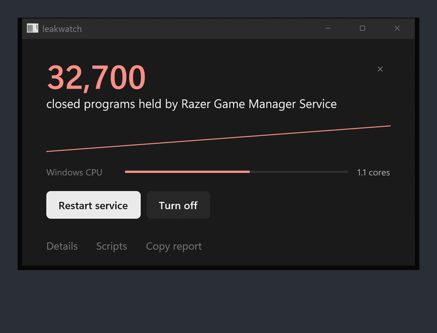
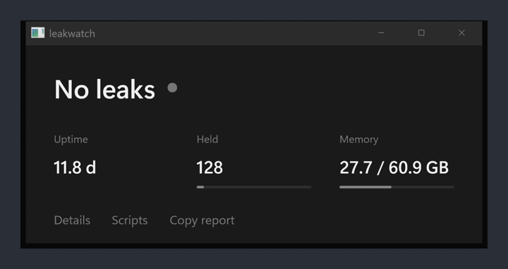
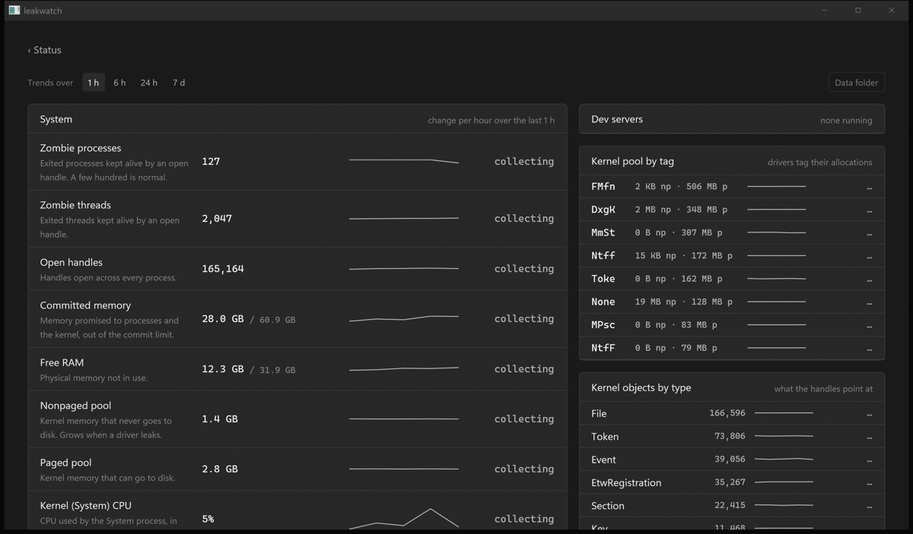

# leakwatch

**Find the program that is slowly breaking Windows, and stop it without restarting.**

<p align="center">
  
  <br><sub>Demo mode, replaying the leak from <a href="https://armanckeser.com/writing/restarting-fixes-windows">Restarting fixes Windows because your apps are broken</a>.</sub>
</p>

Restarting fixes Windows because some program on it leaks: handles it never closes, memory it
never gives back, closed programs it keeps alive. After a few weeks the whole machine stutters, and
a restart wipes the evidence along with the problem.

leakwatch watches for those leaks while your computer runs. When one shows up, it puts the number
that is wrong on screen, names the program or driver behind it, and gives you two buttons: one that
fixes it now and one that fixes it for good. After you press one, it shows whether the number
actually dropped.

If leakwatch is useful to you, starring the repo helps other people find it, and
[armanckeser.com/subscribe](https://armanckeser.com/subscribe) has ways to hear about new releases.

## Use it

1. Download `leakwatch.exe` from [Releases](../../releases) and run it. No installer, no admin.
2. Leave it open. Leaks that build up slowly show after 30 minutes of watching.
3. When a number turns red, press the button under it.

<p align="center">
  
</p>

To see a leak without having one, start it with `LEAKWATCH_DEMO=1` set. Demo buttons don't run
anything.

## What it catches

| Problem | Fix now | Fix for good |
| --- | --- | --- |
| A program keeping thousands of closed programs in memory (zombie processes) | Restart the service, or end the program | Turn the service off, or remove the app from startup |
| A program that keeps opening handles | Same | Same |
| A program whose memory keeps growing | Same | Same |
| A driver leaking kernel memory | Restart Windows | Update or roll back that driver |
| Memory about to run out | Shows the three biggest users | |
| Windows itself using whole CPU cores | | Usually a driver; a kernel trace shows which |
| Copies of the same dev server left running in one project | Stop the older copies | |

Windows notifications fire when a new problem appears, at most once every 30 minutes for each.

## How it finds the culprit

A zombie process is a program that has closed but is still held in memory because another program
has a handle open to it. Windows doesn't count them anywhere you can see. leakwatch counts every
process object the kernel knows about and subtracts the processes that are still running. Then it
reads the system handle table and counts how many process handles each program holds. A program
holding more process handles than there are processes is holding the zombies, and that is the name
on screen.

The other checks follow the same idea: take a sample every 3 seconds, keep a week of history, and
flag a number only when it keeps growing for 30 minutes or crosses a limit. For kernel memory,
leakwatch finds the fastest-growing pool tag and searches the driver files for it, the way
Microsoft's poolmon does, to name the driver.

All of this works without admin rights. Only the fixes ask for them: changing a service opens the
Windows admin prompt, and ending a process is press-and-hold.

## Details

**Details** has everything behind the verdict: trends for every counter over 1 hour to 7 days,
processes sorted by growth, handles, memory and zombies held, kernel memory by pool tag, kernel
objects by type, and dev servers grouped by project. **Copy report** puts the same data in plain
text for a bug report or a chat.

<p align="center">
  
</p>

## Your own scripts

Put one button per line in `%LOCALAPPDATA%\leakwatch\actions.txt`:

```
# label | admin or user | PowerShell command
Restart Explorer | user | Stop-Process -Name explorer -Force
Kernel trace | admin | & 'C:\tools\kernel-trace.ps1'
```

They show up under **Scripts**.

## Data

Everything stays in `%LOCALAPPDATA%\leakwatch\`:

- `system.csv`: one row per minute, used for the 7-day view.
- `actions.txt`: your script buttons.
- `ignored.txt` and `acted.txt`: problems you dismissed, and fixes you ran (for "Back again").

## Build

Rust stable with the MSVC build tools and the Windows SDK:

```
cargo build --release
target\release\leakwatch.exe            # the window
target\release\leakwatch.exe --report   # two samples, plain-text report to stdout
```

Release builds compile shaders with `fxc.exe`. If the build can't find it, set `GPUI_FXC_PATH`, for
example to `C:\Program Files (x86)\Windows Kits\10\bin\10.0.22621.0\x64\fxc.exe`.

The UI is [GPUI](https://gpui.rs), the framework Zed is built on.

## License

GNU AGPL v3, see [LICENSE](LICENSE).
